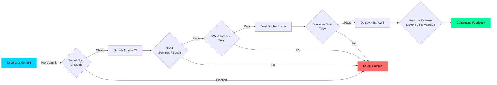
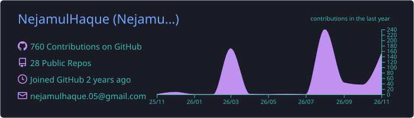
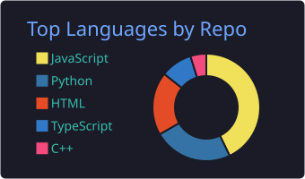
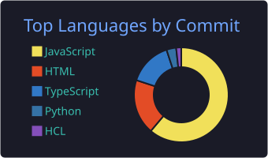

<!-- RELIABLE SVG HEADER BANNER -->

  

<!-- PORTFOLIO & SOCIAL BADGES -->

  
  
  
  

  
  
  

---

### 🛡️ About Me

> *"I don't just write code — I harden and automate the infrastructure it runs on."*

I'm **Nejamul Haque** — a B.Tech CSE ('27) **DevSecOps & Cloud Security Engineer** embedding automated security gates, Infrastructure as Code (IaC) policy checks, and container vulnerability scanning directly into CI/CD pipelines. Security is an architectural boundary, not a late-stage patch.

* 🌐 **Live Portals:** [nejamulhaque.vercel.app](https://nejamulhaque.vercel.app/) (DevSecOps Portfolio) · [haqueandsons.vercel.app](https://haqueandsons.vercel.app/) (Haque & Sons Portal)
* 🔒 **Shift Security Left:** Automated SAST, SCA, Secret Detection, and Terraform IaC scanning via GitHub Actions.
* 🛠️ **Security Tooling Builder:** Creator of *terraform-aws-infra*, *GitShield*, *Sentinel Daemon*, *Irus AI*, *Threat Intel Parser*, and *infra-monitor*.
* 👮 **Cyber Security Experience:** Cyber Security Intern @ Amroha Police, UP Police (APCSIP-2026).

---

### ⚡ Tech Arsenal

| Domain | Technologies & Security Tools |
| :--- | :--- |
| **🐧 Systems & OS** |      |
| **🌐 Networking & Defense** |     |
| **💻 Languages & IaC** |     |
| **🚀 Cloud & Containers** |     |
| **🔧 CI/CD & DevSecOps** |      |

---

### 🚀 Featured DevSecOps & Infrastructure Projects

| Project | Tech Stack | Architecture & Security Impact |
| :--- | :--- | :--- |
| **[terraform-aws-infra](https://github.com/NejamulHaque/terraform-aws-infra)** Zero-Spend AWS Cloud IaC | `Terraform` `AWS` `Trivy` `GitHub Actions` | Modular HCL provisioning AWS VPC, Subnets, Security Groups, EC2, and SSE-S3 encrypted static hosting with automated `terraform fmt/validate` and Trivy IaC policy gates in CI. |
| **[Irus-AI](https://github.com/NejamulHaque/Irus-AI)** Personal AI Command Center | `Python` `Flask` `PostgreSQL` `Docker` | Multi-modal AI assistant (Chat, Search, Doc QA, Memory) backed by a hardened Shift-Left CI pipeline (`Gitleaks -> Bandit -> Trivy -> Pytest`). |
| **[sentinel-daemon](https://github.com/NejamulHaque/sentinel-daemon)** Autonomous Kernel IPS | `Python` `systemd` `iptables` `Linux` | Real-time SSH brute-force detection daemon enforcing kernel-level `iptables` drops. Blocked **14 malicious IPs** in 72 hours at **1.8ms** latency with **0** false positives. |
| **[GitShield](https://github.com/NejamulHaque/GitShield)** Pre-Commit Secret Auditor | `Python` `Regex` `Git Hooks` | Zero-dependency pre-commit security hook blocking AWS IAM credentials, PEM private keys, and insecure file permissions (`chmod 777`) before entering Git history. |
| **[threat-log-parser](https://github.com/NejamulHaque/threat-log-parser)** SIEM-Ready Log Analyzer | `Python` `Threat Feeds` `JSON` | Detects SQLi/XSS attack signatures in web logs, enriches offending IPs via live HTTPS threat intelligence feeds, and exports structured SIEM JSON reports. |

### 📦 Additional Infrastructure & Full-Stack Projects

| Project | Tech Stack | Description |
| :--- | :--- | :--- |
| **[infra-monitor](https://github.com/NejamulHaque/infra-monitor)** | `Python` `Bash` `Linux` `Cron` | Automated Linux system health telemetry, disk/memory threshold alerting, and scheduled cron diagnostics. |
| **[CollabSheets](https://github.com/NejamulHaque/CollabSheets)** | `React` `Node.js` `WebSockets` `PostgreSQL` | Real-time collaborative spreadsheet editor with multi-user synchronization. |
| **[ProResume-Builder](https://github.com/NejamulHaque/ProResume-Builder)** | `Next.js` `Node.js` `PostgreSQL` | ATS-optimized resume builder SaaS with user authentication and persistent storage. |
| **[Nestfy](https://github.com/NejamulHaque/Nestfy)** | `React` `Node.js` `PostgreSQL` | Smart personal finance tracker with automated expense categorization. |

---

### 🧠 DevSecOps Pipeline Architecture

---

### 📊 GitHub Telemetry & Contributions

<!-- SELF-HOSTED STATS CARDS (Generated into output branch) -->

 

  

<!-- CONTRIBUTION SNAKE (Direct img tag for reliable GitHub rendering) -->

### 🎯 Certifications & Engineering Roadmap

| Status | Milestone / Certification | Focus Area |
| :--- | :--- | :--- |
| ✅ **Completed** | **Amroha Police Cyber Security Internship (APCSIP-2026)** | Network Forensics, Threat Analysis & Cyber Defense |
| 🔄 **In Progress** | **AWS Cloud Practitioner · CompTIA Security+** | Cloud Security Architecture, IAM & Network Hardening |
| 🎯 **Next Target** | **CKS (Certified Kubernetes Security Specialist) · AWS Security Specialty** | Cluster Hardening, Runtime Security & Zero-Trust Cloud |

---

### 🌐 Connect & Collaborate

