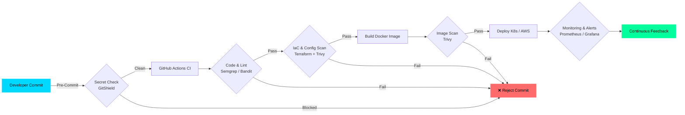

<!-- HEADER BANNER -->

 

<!-- BADGES & PORTFOLIO LINKS -->

  
  

  
  
  
  

 

<!-- TYPING SVG -->

  

---

### 👨‍💻 About Me

> *"I don't just write code — I provision, automate, and harden the cloud infrastructure it runs on."*

I'm **Nejamul Haque** — a 4th-year B.Tech Computer Science & Engineering student (Class of 2027) focused on **Cloud Engineering, DevOps Automation, and Linux Infrastructure**. I build reproducible cloud environments with Infrastructure as Code (IaC), containerized workloads, and automated CI/CD pipelines with built-in security and quality checks.

* 🌐 **Live Portals:**
  * **Cloud & DevOps Portfolio:** [nejamulhaque.vercel.app](https://nejamulhaque.vercel.app/)
  * **Haque & Sons (Tech & Student Portal):** [haqueandsons.vercel.app](https://haqueandsons.vercel.app/)
* ⚙️ **Infrastructure & CI/CD Automation:** Automated Terraform validation, container builds, secret scanning, and deployment pipelines via GitHub Actions.
* 🛠️ **Systems & Tooling Builder:** Creator of *terraform-aws-infra*, *Sentinel Daemon*, *GitShield*, *Irus AI*, and *infra-monitor*.
* 👮 **Industry & Field Experience:** Cyber Security Intern @ Amroha Police, UP Police (APCSIP-2026).

---

### ⚡ Tech Arsenal

<table align="center" width="100%">
  <tr>
    <td align="center" width="50%">
      <h3>🐧 Systems & OS</h3>
      

        
        
        
        
        
      

    </td>
    <td align="center" width="50%">
      <h3>🌐 Networking & Hardening</h3>
      

        
        
        
        
      

    </td>
  </tr>
  <tr>
    <td align="center" width="50%">
      <h3>💻 Languages & Scripting</h3>
      

        
        
        
        
      

    </td>
    <td align="center" width="50%">
      <h3>🔧 Version Control & CI/CD</h3>
      

        
        
        
        
      

    </td>
  </tr>
  <tr>
    <td align="center" width="50%">
      <h3>🚀 Cloud, IaC & Containers</h3>
      

        
        
        
        
      

    </td>
    <td align="center" width="50%">
      <h3>🛡️ Automation, Scanning & Monitoring</h3>
      

        
        
        
        
      

    </td>
  </tr>
</table>

---

### 🚀 Featured Cloud, DevOps & Systems Projects

<table align="center" width="100%">
  <tr>
    <th width="30%">Project</th>
    <th width="28%">Tech Stack</th>
    <th width="42%">Architecture & Engineering Impact</th>
  </tr>
  <tr>
    <td><a href="https://github.com/NejamulHaque/terraform-aws-infra"><b>terraform-aws-infra</b></a> Modular AWS Cloud IaC</td>
    <td><code>Terraform</code> <code>AWS</code> <code>Trivy</code> <code>Actions</code></td>
    <td>Provisions AWS VPC, Subnets, Security Groups, EC2, and SSE-S3 encrypted static hosting via modular HCL with automated <code>terraform fmt/validate</code> and Trivy policy checks in CI.</td>
  </tr>
  <tr>
    <td><a href="https://github.com/NejamulHaque/Irus-AI"><b>Irus AI</b></a> Containerized AI Assistant</td>
    <td><code>Python</code> <code>Flask</code> <code>PostgreSQL</code> <code>Docker</code></td>
    <td>Multi-modal AI assistant (Chat, Search, Doc QA, Memory) deployed via an automated CI/CD pipeline (<code>Gitleaks → Bandit → Trivy → Pytest</code>).</td>
  </tr>
  <tr>
    <td><a href="https://github.com/NejamulHaque/sentinel-daemon"><b>Sentinel Daemon</b></a> Linux Firewall Automation</td>
    <td><code>Python</code> <code>systemd</code> <code>iptables</code> <code>Linux</code></td>
    <td>Background Linux daemon parsing SSH logs in real time to enforce kernel-level <code>iptables</code> blocks. Mitigated <b>14 brute-force IPs</b> in 72 hours at <b>1.8ms</b> latency with <b>0</b> false positives.</td>
  </tr>
  <tr>
    <td><a href="https://github.com/NejamulHaque/GitShield"><b>GitShield</b></a> Pre-Commit Secret Auditor</td>
    <td><code>Python</code> <code>Regex</code> <code>Git Hooks</code></td>
    <td>Zero-dependency Git pre-commit hook preventing AWS credentials, PEM private keys, and unsafe permissions (<code>chmod 777</code>) from entering version control.</td>
  </tr>
  <tr>
    <td><a href="https://github.com/NejamulHaque/threat-log-parser"><b>Threat Intel Parser</b></a> Log Analysis & Enrichment CLI</td>
    <td><code>Python</code> <code>REST APIs</code> <code>JSON</code></td>
    <td>Parses web access logs for SQLi/XSS anomalies, enriches flagged IPs against live HTTPS threat feeds, and exports structured JSON telemetry reports.</td>
  </tr>
</table>

<b>📦 More Projects (Infrastructure Monitoring & Full-Stack Applications)</b>

 

| Project | Description | Tech Stack |
| :--- | :--- | :--- |
| [infra-monitor](https://github.com/NejamulHaque/infra-monitor) | Automated Linux system health telemetry, disk/memory alerting, and cron diagnostics | Python, Bash, Linux, Cron |
| [CollabSheets](https://github.com/NejamulHaque/CollabSheets) | Real-time collaborative spreadsheet web app powered by WebSockets | React, Node.js, WebSockets, PostgreSQL |
| [ProResume-Builder](https://github.com/NejamulHaque/ProResume-Builder) | ATS-friendly resume builder SaaS with authentication and database persistence | Next.js, Node.js, PostgreSQL |
| [Nestfy](https://github.com/NejamulHaque/Nestfy) | Smart personal finance tracker with automated expense categorization | React, Node.js, PostgreSQL |

  

---

### 🧠 Automated CI/CD & Cloud Delivery Pipeline

---

### 📊 GitHub Telemetry & Contributions

<!-- STATS & TOP LANGUAGES -->

  
  

<!-- STREAK -->

  

<!-- ACTIVITY GRAPH -->

  

<!-- CONTRIBUTION SNAKE -->

  <picture>
    <source media="(prefers-color-scheme: dark)" srcset="https://raw.githubusercontent.com/NejamulHaque/NejamulHaque/output/github-contribution-grid-snake-dark.svg"/>
    <source media="(prefers-color-scheme: light)" srcset="https://raw.githubusercontent.com/NejamulHaque/NejamulHaque/output/github-contribution-grid-snake.svg"/>
    
  </picture>

---

### 🎯 Certifications & Engineering Roadmap

| Status | Milestone / Certification | Focus Area |
| :--- | :--- | :--- |
| ✅ **Completed** | **Amroha Police Cyber Security Internship (APCSIP-2026)** | Network Forensics, Threat Analysis & System Defense |
| 🔄 **In Progress** | **AWS Certified Cloud Practitioner · HashiCorp Terraform Associate** | AWS Core Architecture, IAM, VPC & Infrastructure as Code |
| 🎯 **Next Target** | **CKAD (Certified Kubernetes Application Developer) · RHCSA** | Container Orchestration, Cluster Operations & Linux Admin |

---

### 🌐 Connect & Collaborate

  
  

  
  
  
  

 

  

